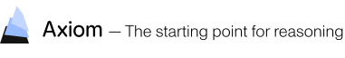

[](https://axiommath.ai/)

# The Weil Conjectures in Lean

A Lean 4 (v4.34.0-rc2) formalization of the proof of the Weil conjectures, following E. Freitag and R. Kiehl, *Étale Cohomology and the Weil Conjecture* (Ergebnisse der Mathematik 13, Springer, 1988), built on [Mathlib](https://github.com/leanprover-community/mathlib4) and on [the Stacks Project in Lean](https://github.com/AxiomMath/Stacks). All four Weil conjectures are proved: rationality, the functional equation, the Riemann hypothesis (Deligne's theorem) and the Betti-number statement. Lean's kernel checks every proof. There is no `sorry`, no `native_decide` and no added axiom.

## The Weil conjectures

Throughout, `k` is a finite field with `q` elements, `k̄` an algebraic closure, `ℓ ≠ char k` a prime, and for a scheme `X` over `k` the *zeta series* is

$$Z_X(t) = \exp\Bigl(\sum_{m \ge 1} \frac{|X(\mathbb F_{q^m})|}{m} t^m\Bigr) \in \mathbb Q[[t]]$$

(`AlgebraicGeometry.zetaSeries`). For `X` smooth and proper over `k`, `P_ν(t) = det(1 − t·F | H^ν(X_k̄, ℚ_ℓ)) ∈ ℚ_ℓ[t]` is the characteristic polynomial of the geometric Frobenius on étale cohomology (`Weil.rationalFrobeniusCharpolyReverse`). Unless noted, all files are under `Weil/AlgebraicGeometry/EtaleCohomology/Trace/`.

### 1. Rationality

For every scheme `X` of finite type over `k`, `Z_X(t)` is a rational function: there are `P, Q ∈ ℚ[t]` with `Q(0) = 1` and `Q·Z_X = P`.

```lean
theorem AlgebraicGeometry.exists_mul_zetaSeries_eq {X : Scheme.{u}} (f : X ⟶ Spec (.of k))
    [LocallyOfFiniteType f] [QuasiCompact f] :
    ∃ P Q : Polynomial ℚ, Q.coeff 0 = 1 ∧ (Q : ℚ⟦X⟧) * zetaSeries f = P
```

(`ZetaRationality.lean`.) Moreover `Z_X(t) = ∏_ν P_ν(t)^{(-1)^{ν+1}}` for `X` proper (Grothendieck's trace formula), and the `P_ν` have integer coefficients independent of `ℓ` (`Weil.exists_map_int_eq_rationalFrobeniusCharpolyReverse`, `Weil.exists_map_int_eq_rationalFrobeniusCharpolyReverse_and`).

### 2. Functional equation

Let `X` be smooth and projective over `k` of pure dimension `n`, with Euler characteristic `χ = ∑ (−1)^ν dim H^ν(X_k̄, ℚ_ℓ)`. Then `nχ` is even and, in `ℚ_ℓ(t)`,

$$Z_X\Bigl(\frac{1}{q^n t}\Bigr) = \varepsilon q^{n\chi/2} t^{\chi} Z_X(t), \qquad \varepsilon = \pm 1 .$$

```lean
theorem Weil.prod_aeval_inv_rationalFrobeniusCharpolyReverse_zpow_eq :
    Even ((n : ℤ) * eulerCharacteristic B S f ℓ) ∧
    ∏ ν ∈ Finset.range (2 * n + 1),
        (Polynomial.aeval ((algebraMap ℚ_[ℓ] (RatFunc ℚ_[ℓ]) ((Fintype.card k : ℚ_[ℓ]) ^ n) *
          RatFunc.X)⁻¹) (rationalFrobeniusCharpolyReverse B S f ℓ ν)) ^ ((-1 : ℤ) ^ (ν + 1)) =
      (functionalEquationSign B S f ℓ n : RatFunc ℚ_[ℓ]) *
        (Fintype.card k : RatFunc ℚ_[ℓ]) ^ ((n : ℤ) * eulerCharacteristic B S f ℓ / 2) *
        RatFunc.X ^ eulerCharacteristic B S f ℓ *
        ∏ ν ∈ Finset.range (2 * n + 1),
          (algebraMap ℚ_[ℓ][X] (RatFunc ℚ_[ℓ]) (rationalFrobeniusCharpolyReverse B S f ℓ ν)) ^
            ((-1 : ℤ) ^ (ν + 1))
```

(`DeligneFunctionalEquation.lean`; `S` is smooth of relative dimension `n` and proper over `k`.) It follows from Poincaré duality.

### 3. Riemann hypothesis (Deligne's theorem)

For `X` smooth and proper over `k` and every `ν`, every eigenvalue `λ` of Frobenius on `H^ν(X_k̄, ℚ_ℓ)` is an algebraic number with `|ι(λ)| = q^{ν/2}` for every complex embedding `ι`.

```lean
theorem Weil.satisfiesWeilEstimate (S : B.Scheme) (f : S.1 ⟶ Spec (.of k)) [IsProper f] [Smooth f] :
    SatisfiesWeilEstimate B S f ℓ
```

(`DeligneWeilConjecture.lean`.) In Weil's original form, for `X` smooth, proper and geometrically irreducible of dimension `d` there are `f_0, …, f_{2d} ∈ ℤ[t]` with `f_j(0) = 1`, `f_0 = 1 − t`, `f_{2d} = 1 − q^d t`, all inverse roots of `f_j` of absolute value `q^{j/2}`, and `Z_X · f_0 f_2 ⋯ f_{2d} = f_1 f_3 ⋯ f_{2d−1}`:

```lean
theorem Weil.exists_zetaSeries_mul_prod_even_eq_prod_odd {X : Scheme.{u}} (f : X ⟶ Spec (.of k))
    (d : ℕ) [IsProper f] [SmoothOfRelativeDimension d f] [GeometricallyIrreducible f] :
    ∃ P : ℕ → ℤ[X],
      (∀ j ≤ 2 * d, (P j).coeff 0 = 1) ∧ P 0 = 1 - Polynomial.X ∧
      P (2 * d) = 1 - C ((Fintype.card k : ℤ) ^ d) * Polynomial.X ∧
      (∀ j ≤ 2 * d, ∀ z : ℂ, z ≠ 0 → aeval z⁻¹ (P j) = 0 →
        ‖z‖ = (Fintype.card k : ℝ) ^ ((j : ℝ) / 2)) ∧
      zetaSeries f * ∏ j ∈ (Finset.range (2 * d + 1)).filter Even,
          (((P j).map (Int.castRingHom ℚ) : ℚ[X]) : PowerSeries ℚ) =
        ∏ j ∈ (Finset.range (2 * d + 1)).filter (¬ Even ·),
          (((P j).map (Int.castRingHom ℚ) : ℚ[X]) : PowerSeries ℚ)
```

(`WeilRiemannHypothesisForm.lean`.) Deligne's theorem is obtained from the Stacks Project's `LAdicSheaf.weightBound` (Tag 03VH, proved in StacksFrontier along Laumon's Fourier-transform route).

### 4. Betti numbers

If `X` smooth and projective over `k` arises by good reduction of a smooth projective `Y` over `ℂ`, then `deg P_ν = b_ν(Y)`, the `ν`-th Betti number of `Y(ℂ)`: the dimension of the sheaf cohomology `H^ν(Y(ℂ), ℂ)` of the constant sheaf `ℂ` on `Y(ℂ)` with its analytic topology, which is proved finite-dimensional (`AlgebraicGeometry.Scheme.finiteDimensional_complexCohomology`).

```lean
theorem Weil.natDegree_rationalFrobeniusCharpolyReverse_eq_bettiNumber
    (B : BigEtaleSite.{0}) (S₀ : B.Scheme) {κ : Type} [Field κ] [Fintype κ]
    (s₀ : S₀.1 ⟶ Spec (.of κ)) [Smooth s₀] [IsProper s₀] (hs₀ : IsProjective s₀)
    {Y : Scheme.{0}} (y : Y ⟶ Spec (.of ℂ)) [Smooth y] (hy : IsProjective y)
    (h : Scheme.ArisesByGoodReduction s₀ y) (ℓ : ℕ) [Fact ℓ.Prime] [Fact (ℓ ≠ ringChar κ)] (ν : ℕ) :
    (Weil.rationalFrobeniusCharpolyReverse B S₀ s₀ ℓ ν).natDegree = Scheme.bettiNumber y ν
```

(`BettiNumber.lean`.) The proof goes through Artin's comparison theorem between étale and analytic cohomology, also formalized here (`Weil/AlgebraicGeometry/ComplexPoints/Betti/`). The intrinsic form `deg P_ν = dim_{ℚ_ℓ} H^ν(X_k̄, ℚ_ℓ)` is `Weil.natDegree_rationalFrobeniusCharpolyReverse` (`CharpolyDegree.lean`).

### All in one statement, with Mathlib only

The statement of the LeanEval problem [`weil_conjectures`](https://lean-lang.org/eval/problems/weil_conjectures/) (from [lean-eval](https://github.com/leanprover/lean-eval)), which uses only Mathlib definitions, is proved verbatim as `LeanEval.AlgebraicGeometry.WeilConjectures.weil_conjectures` in [Weil/LeanEval/WeilConjectures.lean](Weil/LeanEval/WeilConjectures.lean):

```lean
theorem weil_conjectures (F : Type*) [Finite F] [Field F]
    (X : Over (Spec (.of F))) [GeometricallyIrreducible X.hom] [IsProper X.hom]
    (d : ℕ) [SmoothOfRelativeDimension d X.hom] :
    ∃ A : ℕ → Multiset ℂ, A 0 = {1} ∧
      (∀ i ≤ 2 * d, A (2 * d - i) = (A i).map (Nat.card F ^ d / · : ℂ → ℂ) ∧
        (∀ φ : ℂ ≃+* ℂ, (A i).map φ = A i) ∧
        ∀ α ∈ A i, IsIntegral ℤ α ∧ ‖α‖ = √(Nat.card F ^ i)) ∧
      ∀ (E : Type _) [Field E] [Algebra F E] [FiniteDimensional F E],
        Nat.card (.mk (Spec.map <| CommRingCat.ofHom <| algebraMap F E) ⟶ X) =
        ∑ i ∈ Finset.Iic (2 * d), (-1) ^ i * ((A i).map (· ^ Module.finrank F E)).sum
```

Here `A i` is the multiset of Frobenius eigenvalues on `H^i(X_F̄, ℚ_ℓ)`, sent into `ℂ` by an embedding of `ℚ̄_ℓ`: the point-count formula is the trace formula, `A (2d − i) = q^d / A i` is Poincaré duality, Galois stability and integrality come from the integrality of the `P_i`, and `‖α‖ = q^{i/2}` is Deligne's theorem.

## Structure

`import Weil` brings in the whole library, [Weil](Weil/), about 980 modules written by AI agents. Every proof is kernel-checked; the code has not yet been reviewed by humans.

A declaration that formalizes an item of Freitag–Kiehl carries the attribute `@[weil "label"]` (defined in [Weil/Attr.lean](Weil/Attr.lean)), where the label names the item, for example `thm_fk404_deligne_weil_conjecture` for FK IV.4, Deligne's theorem.

The formalization follows the conventions of the Stacks Project in Lean: the étale site is its `SmallEtale` inside a `BigEtaleSite`, geometric points are over algebraically closed fields, and ℓ-adic sheaves are its strict projective systems `LAdicSheaf` (Tag 03UM). Where Freitag–Kiehl's printed definition is defective, the standard (EGA / Stacks / Mathlib) meaning is used, and the module docstrings say where a statement differs from the book.

## Axioms

Proofs use only the standard axioms `propext`, `Classical.choice` and `Quot.sound`. After `import Weil`, `#print axioms` on any declaration lists exactly what it rests on, for example

```lean
#print axioms LeanEval.AlgebraicGeometry.WeilConjectures.weil_conjectures
-- 'LeanEval.AlgebraicGeometry.WeilConjectures.weil_conjectures' depends on axioms: [propext, Classical.choice, Quot.sound]
```

## Building

```
lake exe cache get
lake build
```

`lake exe cache get` downloads Mathlib's compiled files. The Stacks Project modules this library uses are compiled locally, so the first build takes a long time and a lot of memory.

## License

[Apache 2.0](LICENSE).
